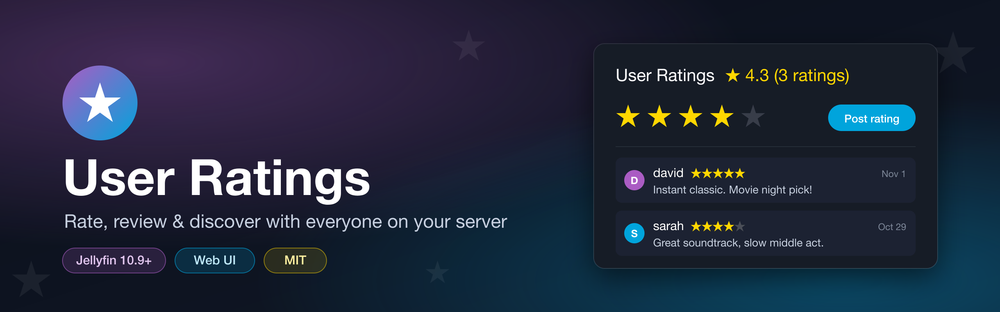
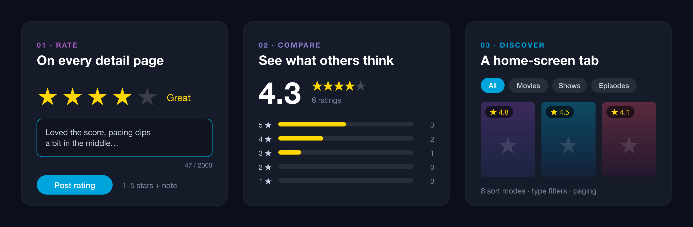

<p align="center">
  
</p>

<p align="center">
  <a href="https://opensource.org/licenses/MIT"></a>
  <a href="https://jellyfin.org/"></a>
  
  
</p>

> **Origin:** this plugin is based on an earlier version of [Jellyfin.Plugin.UserRating](https://github.com/aG00Dtime/Jellyfin.Plugin.UserRating) by David Henry. It has since been reworked and is now maintained here as a separate project.

A social rating system for Jellyfin. Users rate movies, shows and episodes from 1 to 5 stars and can add a note. Everyone on the server can then see those ratings on each item's page, and a **User Ratings** tab on the home screen lists everything that has been rated.

**Quick install:** add this repository in **Dashboard → Plugins → Repositories** (copy button on the right):

```text
https://raw.githubusercontent.com/AntoineDemy/UseRating/main/manifest.json
```

> **Note:** works in the **web UI** only (desktop and mobile browsers). Native apps (Android TV, Swiftfin, …) don't load plugin scripts.

<p align="center">
  
</p>

---

## Features

**On item detail pages**
- ⭐ 1–5 star picker with labels (*Awful → Masterpiece*), keyboard accessible
- 💬 Optional note (up to 2000 characters, with a live counter)
- 📊 Score summary: the average, the number of ratings, and a breakdown of how many people gave each star count
- 👥 Every user's review with an avatar, their stars, their note and a relative date ("2 days ago")
- ✏️ Update or delete your own rating at any time

**User Ratings home tab**
- 📈 Server stats: titles rated, total ratings, overall average
- 🕒 *Recently rated* rows for movies, shows and episodes (row length is configurable)
- 🗂️ *All rated items* grid: filter by type, choose one of 8 sort orders, 24 items per page
- 🖼️ Native Jellyfin cards; episodes fall back to the series poster

**Under the hood**
- 🔒 Every endpoint requires authentication. The acting user comes from the session token, so nobody can rate on someone else's behalf
- ⚡ No polling and no page reloads: a single idempotent sync runs on navigation and DOM changes
- 💾 Ratings are stored in a plain JSON file, so nothing is written to Jellyfin's database

## Installation

### From the plugin repository

Repository URL (click the copy icon on the right of the box):

```text
https://raw.githubusercontent.com/AntoineDemy/UseRating/main/manifest.json
```

1. **Dashboard → Plugins → Repositories → +**
2. Paste the URL above
3. **Catalog** → **User Ratings** → **Install**
4. Restart Jellyfin

### Manual

1. Build the plugin (see [Building](#building)) or download a release zip
2. Copy `Jellyfin.Plugin.UserRatings.dll` into `<jellyfin-config>/plugins/UserRatings/`
3. Restart Jellyfin

No setup is needed. After the restart, the ratings panel appears on detail pages and the **User Ratings** tab appears next to *Home / Favorites*.

## Usage

**Rate something**
1. Open a movie, show or episode in the web UI
2. Scroll to the **User Ratings** panel
3. Pick your stars, optionally write a note, then click **Post rating** (or **Update** if you have already rated it)

**Browse ratings**
1. On the home screen, open the **User Ratings** tab
2. Look through the *Recently rated* rows, or scroll down to *All rated items*
3. Filter by **All / Movies / Shows / Episodes** and pick a sort order:
   rating (high/low), title (A–Z/Z–A), recently or oldest rated, most or fewest ratings
4. Click a card to open the item

## Configuration

**Dashboard → Plugins → User Ratings**

| Setting | Range | Default | Effect |
|---|---|---|---|
| Recently rated items count | 5–50 | 10 | Number of items in each *Recently rated* row |

## API

All endpoints require an authenticated Jellyfin session (`X-Emby-Token`). The acting user is taken from the token.

| Method | Route | Description |
|--------|-------|-------------|
| `GET` | `/UserRatings/Items/{itemId}` | An item's ratings, its average and the caller's own rating |
| `POST` | `/UserRatings/Items/{itemId}` | Rate an item. Body: `{ "Rating": 1-5, "Note": "optional, max 2000 chars" }` |
| `DELETE` | `/UserRatings/Items/{itemId}` | Delete the caller's rating |
| `GET` | `/UserRatings/Items` | Summary of every rated item, plus the `RecentlyRatedItemsCount` setting |
| `GET` | `/UserRatings/Me` | Every rating the caller has made |
| `DELETE` | `/UserRatings` | Delete every rating (admin only) |

Ratings are stored in `<config>/plugins/configurations/UserRatings/ratings.json`.

## Building

Jellyfin's plugin API changes between release lines, so the plugin is built once per line (10.9, 10.10, 10.11, 12.x) against the matching `Jellyfin.Controller` package. The build runs in Docker:

```bash
./build.sh            # all release lines
./build.sh 10.11.0    # a single one
```

Each build produces `releases/user-ratings_<version>_jellyfin-<jellyfin>.zip` and prints its MD5 checksum. Add one entry per zip to `manifest.json` (newest `targetAbi` first).

```
Api/RatingsController.cs      REST endpoints
Data/RatingRepository.cs      JSON-backed storage (singleton)
Configuration/ratings.js      web UI: detail panel + home tab
Configuration/configPage.html dashboard settings page
assets/                       banner, feature art, icon sources (SVG)
```

To regenerate the artwork after editing an SVG:

```bash
rsvg-convert -w 2560 assets/banner.svg   -o assets/banner.png
rsvg-convert -w 2560 assets/features.svg -o assets/features.png
rsvg-convert -w 512  assets/icon.svg     -o icon.png
```

## Use cases

- **Family server:** check how everyone rated a film before movie night ("Dad gave it 5 stars, Mom gave it 3")
- **Friend group:** sort by *Most ratings* or *Rating: high to low* to find the crowd favourites
- **Shared library:** use notes as short reviews and spoiler-free recommendations

## License

MIT. See [LICENSE](LICENSE).

<p align="center"><br><sub>Made for the Jellyfin community</sub></p>
